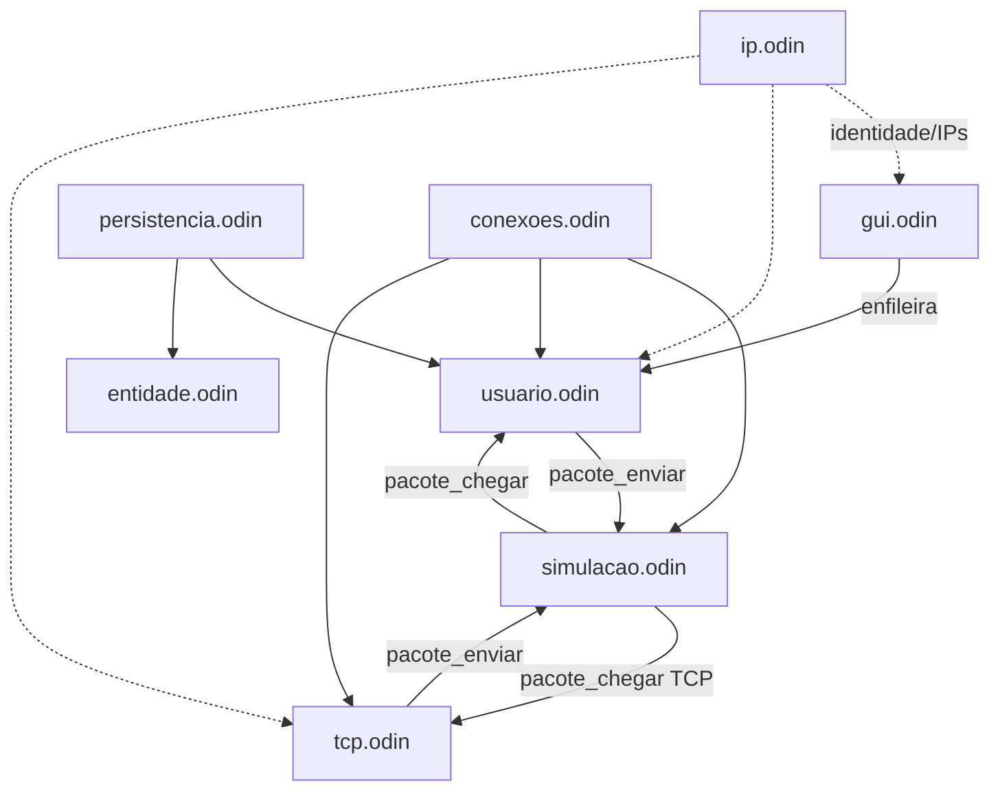
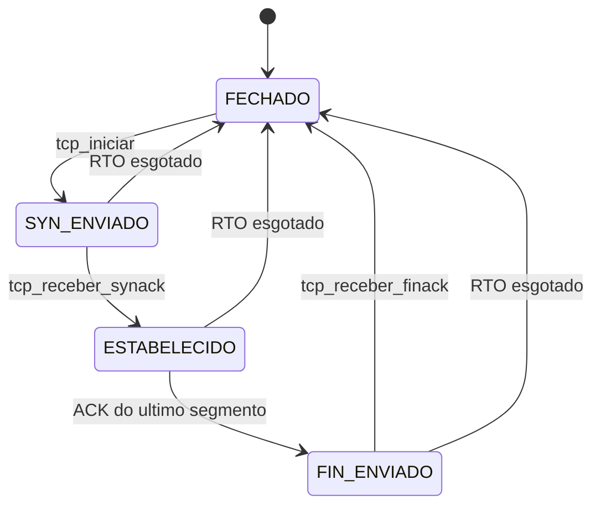

# SICOMPA — Relatório do estado atual (base para refatoração)

> **Propósito**: fotografar o estado real do código antes de qualquer refatoração.
> Este documento é a fonte de verdade para as fases seguintes (criar código → testar/depurar → documentar).
>
> **Método**: leitura integral de `src/*.odin` (14 arquivos), `plan/resumo.md`, `AGENTS.md`, `build.sh`, `run.sh` e dos esquemas de exemplo (`teste1.json`, `sla.json`). Nenhum build/teste foi executado (sem toolchain neste container — ver §5).
>
> **Data**: 2026-10-13 · **Versão**: v1

---

## 1. O que o projeto faz atualmente

**SICOMPA** é um simulador didático de rede de comutação de pacotes em **Odin + Raylib**. O usuário monta uma topologia na tela, cria mensagens e observa os pacotes trafegando visualmente. O roteamento é feito por **flooding** (inundação) com controle de loops por `historico` + `TTL`.

### 1.1 Loop principal (`main.odin`)

```
entidades_atualizar() → simulacao_atualizar() → notificacoes_atualizar()
   ↓ render
conexoes_renderizar() → entidades_renderizar() → pacotes_renderizar() → gui_renderizar()
   ↓
free_all(context.temp_allocator)
```

- Em `ODIN_DEBUG`: alocador rastreador (`mem.Tracking_Allocator`) + handle maps **estáticos** (`Static_Handle_Map(1024, …)`).
- Em release: handle maps **dinâmicos** (`hm.dynamic_init/destroy`).
- Carrega 3 sprites globais: `icon_map.png` (`Usuario`), `icon_tower.png` (`Comutador`), `resumo.png` (`Resumo`).
- `SetTargetFPS(180)`, janela redimensionável + high DPI, `DrawFPS` em debug.
- `defer` de saída: `simulacao_limpar()`, `delete(pacotes)`, `notificacoes_limpar()`, `delete(notificacoes)`.

### 1.2 Modelo de dados

- **`Entidade`** (`entidade.odin`): `handle`, `dados: Dados` (union `Comutador | Usuario`), `sprite`, `posicao` (**centro**), `offset_mouse`, `colisor_mouse`, `segurado`. `EntidadeID :: hm.Handle32`.
- **`Conexao`** (`conexoes.odin`): `handle`, `a`, `b`. `ConexaoID :: hm.Handle32`.
- **`Usuario`** (`usuario.odin`): `alocador`, `nome`, `ip`, `saida`, `enviadas`, `entrada`, `recebidas`, `envio: EnvioPendente`, `envio_ativo`, **`tcp_envio: TcpEnvio`**, **`tcp_recebidas: [dynamic]RecebimentoTCP`**.
- **`Comutador`** (`comutador.odin`): apenas `id: u32` sequencial.
- **`Pacote`** (`pacote.odin`): hoje é uma estrutura "gorda" que carrega campos de UDP, de TCP e de roteamento ao mesmo tempo (§3.3).

### 1.3 Camada de endereçamento IP (`ip.odin`)

- `Ip :: distinct [4]u8`, `IP_AUTO_BASE :: {192,168,0,0}`, `IP_VAZIO :: Ip{}`.
- `ip_para_string` (temp allocator), `ip_de_string` (parse + validação 0..255), `ip_em_uso` (varre usuários), `ip_sugerido` (primeiro livre `192.168.0.1..254`), `ip_entidade` (IP do usuário; zero para comutador).
- O IP é usado como **identidade/exibição**: rótulo sob o sprite, rótulo do dropdown (`"nome (ip)"`), logs e campos `ip_origem`/`ip_destino` do `Pacote`. **O roteamento continua 100% por handle** — nenhum pacote é entregue/encaminhado por IP.
- IP editável no modal "Criar Usuário" (validação `ip_de_string` + unicidade `ip_em_uso`, sem fechar o modal em erro).
- Persistido no JSON (esquema v2).

### 1.4 Transporte — UDP (`usuario.odin` + `simulacao.odin`)

- **Fragmentação**: `RUNES_POR_PACOTE :: 8` runes por pacote; `total = ceil(len(runes)/8)`.
- **Envio com delay**: `usuario_atualizar_envio` retira 1 mensagem de `saida`, envia o 1º fragmento imediatamente e os demais a cada `DELAY_ENTRE_PACOTES :: 0.8`s. Sem vizinhos → mensagem descartada com aviso.
- **`usuario_enviar_fragmento`**: monta `Pacote` (bytes = sub-slice de `envio.runes`, `cor = cor_para_mensagem(id)`, `ttl = TTL_PADRAO`) e envia um **clone** a cada vizinho.
- **Recepção**: dedupe por `mensagem_id` (já em `recebidas`) e por `(mensagem_id, indice)` (em `entrada`); ao atingir `total` fragmentos, remonta em ordem, move para `recebidas` e notifica. Sem confiabilidade: fragmentos perdidos nunca são retransmitidos.

### 1.5 Transporte — TCP (`tcp.odin`, ~572 linhas, **novo**)

Modelo didático: **handshake em 3 vias por flooding** + **segmentos de dados por rota fixa (source routing)** + **stop-and-wait** + **FIN/FIN-ACK**.

- **Emissor** (`TcpEnvio` + `EstadoTCP = {FECHADO, SYN_ENVIADO, ESTABELECIDO, FIN_ENVIADO}`):
  - `tcp_iniciar`: converte conteúdo em runes, cria `TcpEnvio` e **inunda** o SYN (`flags={SYN}`).
  - `tcp_receber_synack`: fixa `rota_ida = reverse(historico_do_SYN_ACK) + origem`, inunda um ACK (estabelecimento), vai para `ESTABELECIDO` e envia o 1º segmento de dados.
  - `tcp_enviar_dados(seq)`: fatia `runes` em blocos de 8 e envia pela `rota_ida`.
  - `tcp_receber_ack`: `ack == base+1` → avança a base; se `base < total` envia o próximo segmento, senão envia FIN (`FIN_ENVIADO`).
  - `tcp_receber_finack`: `tcp_concluir` (libera buffers).
  - `tcp_atualizar`: RTO (`tcp_rto`, configurável) esgotado → retransmite conforme o estado; após `tcp_max_tentativas` aborta com `mostrar_mensagem("TCP: sem resposta; conexão abortada.")`.
- **Receptor** (`RecebimentoTCP`): `tcp_receber_syn` cria/reusa estado e responde SYN-ACK (flood); `tcp_receber_dados` acumula em ordem e **sempre** responde ACK cumulativo (`ack = proximo_seq`) pela `rota_volta`; `tcp_receber_fin` remonta a string, registra em `recebidas`, notifica e responde FIN-ACK.
- **Roteamento** (`pacote_chegar`, `usar_rota`): salta `rota[rota_indice+1]` sem histórico; se o próximo nó não existe → `"ROTA INVÁLIDA"`/`"ROTA FIM"` e o pacote é **descartado em silêncio**.
- **Localização da rota**: `tcp_definir_rota` = `reverse(p.historico)` + `p.origem` (deduz o caminho a partir do `historico` acumulado pelo flooding).
- **Configuração**: `tcp_rto` (0.2–5.0 s) e `tcp_max_tentativas` (1–10) via sliders na GUI; `TCP_JANELA :: 1` (não usado).
- **Render**: TCP vira um **quadrado rotacionado 45°** com rótulo textual (`SYN`, `SYN-ACK`, `ACK`, `FIN`, `FIN-ACK`, `seq N`); UDP continua círculo.

### 1.6 Simulação e roteamento (`simulacao.odin`)

- Globais: `pacotes`, `simulacao_ativa`, `proximo_mensagem_id`, `logs_ativos` (default ON), `probabilidade_perda` (0..1).
- `perder_pacote()`: sorteio por salto com `probabilidade_perda`.
- `pacote_enviar` define `de`/`para`, zera `progresso`, loga `"SALTO"` e enfileira.
- `pacote_chegar`: (1) perda → descarta; (2) `para == destino` → **entrega** (`UDP → usuario_receber`, `TCP → tcp_receber`); (3) se não é comutador → ignora; (4) `ttl <= 1` → descarta; senão `ttl--` e: com `usar_rota` segue a rota; sem rota, se o destino é vizinho → **ROTA DIRETA**; senão **FLOOD** para vizinhos fora de `de`/`historico`.
- `simulacao_atualizar`: `progresso += VELOCIDADE_PACOTE*dt/distância`; ao chegar (`>=1.0`), chama `pacote_chegar` e libera o pacote; para sozinha quando `pacotes` vazio e `!simulacao_tem_pendencia()`.
- `simulacao_tem_pendencia`: considera `saida`, `envio_ativo` **e `tcp_envio.ativo`**; ignora fragmentos parciais de `entrada`.
- `simulacao_limpar`: libera pacotes, limpa o array, **`tcp_limpar_todos()`** e desativa a simulação.

### 1.7 GUI (`gui.odin`), resumo (`resumo.odin`) e notificações (`notificacoes.odin`)

- **Coluna superior-esquerda**: `Criar Usuário`, `Criar Comutador`, `Nova Mensagem`, `Exportar`, `Importar`, `Logs: ON/OFF` (todos bloqueados por `algum_modal_aberto()`).
- **Modais**: mensagem (dropdowns Origem/Destino + toggle `UDP;TCP` + textbox), arquivo (Salvar/Abrir + Cancelar), nome de usuário (Nome + IP pré-preenchidos) e resumo. Dropdowns desenhados por último.
- **Barra inferior**: estado (`Pausado`/`Rodando`), `Iniciar/Pausar`, `Limpar`, slider `Perda%`.
- **Barra TCP** (acima da inferior): sliders `RTO (s)` e `Tentativas`.
- **Popup** `mostrar_mensagem` com buffer fixo `[256]u8` e timer `MENSAGEM_DURACAO :: 2.5`s.
- **Resumo**: ícone no canto superior-direito do usuário → modal com tabela **Tipo | Protocolo | Contraparte | Conteúdo**, rolagem por roda, `BeginScissorMode`.
- **Notificações**: cartões empilhados no topo-direito, ~4 s (`NOTIFICACAO_DURACAO`), com fade.

### 1.8 Persistência (`persistencia.odin`) e logs

- Esquema JSON **`VERSION_ESQUEMA :: 2`**: `Esquema{versao, entidades[], conexoes[]}`; `EntidadeEsquema{tipo, x, y, nome, ip}` (conexões por **índice**). Mensagens/pendências **não** são persistidas.
- Export: `json.marshal` pretty (4 espaços) + `os.write_entire_file`; nome ganha `.json` se faltar.
- Import: `os.read_entire_file` + `json.unmarshal`; rejeita `versao > 2` e esquema sem entidades; `entidades_limpar()` + zera contadores de id + recria entidades preservando tipo/posição/nome/ip + refaz conexões.
- **Logs** (console, `logs_ativos`): cada evento (`SALTO`, `ENTREGA`, `PERDIDO`, `TTL ESGOTADO`, `FLOOD`, `ROTA DIRETA`, `ROTA`, `ROTA FIM`, `ROTA INVÁLIDA`) com mensagem, protocolo, IPs, TTL e histórico; TCP acrescenta rótulo/`seq`/`ack`.

### 1.9 Fluxo de dados (visão rápida)



### 1.10 Máquina de estados do emissor TCP



---

## 2. Atualizações não documentadas em `AGENTS.md`

> **Nota**: `AGENTS.md` não está "levemente" desatualizado — a seção de TCP **contradiz** o código. A camada IP, por outro lado, **já está quase toda descrita**; o delta ali é pequeno (§2.3).

### 2.1 TCP: implementado, mas descrito como "fase futura"

| `AGENTS.md` afirma | Realidade no código |
|---|---|
| "**Apenas UDP está implementado**; TCP é reservado para fase futura." | `tcp.odin` tem ~572 linhas: handshake SYN/SYN-ACK/ACK, dados por rota fixa, ACK cumulativo, RTO, retransmissão, aborto por tentativas, FIN/FIN-ACK. |
| `transporte.odin`: "Apenas UDP tem semântica implementada." | `transporte.odin` só define `Protocolo`/`nome_protocolo`; a semântica TCP vive em `tcp.odin`. O comentário interno também está obsoleto (§3.6). |
| `Pacote{origem, destino, ip_origem, ip_destino, protocolo, ttl, mensagem_id, indice, total, bytes, historico, de, para, progresso, cor}` | Agora tem também: `seq: u32`, `ack: u32`, `flags: FlagsTCP`, `janela: u16`, `rota: [dynamic]EntidadeID`, `rota_indice: int`, `usar_rota: bool`. Novos tipos `FlagTCP{SYN,ACK,FIN}` e `FlagsTCP :: bit_set[FlagTCP; u8]`. |
| `Usuario{..., envio, envio_ativo}` | Agora tem também `tcp_envio: TcpEnvio` e `tcp_recebidas: [dynamic]RecebimentoTCP`. |
| `usuario_atualizar_envio` descrito só como envio UDP | Agora **despacha para TCP**: se `tcp_envio.ativo` chama `tcp_atualizar`; e ao retirar de `saida`, se `protocolo == .TCP` chama `tcp_iniciar`. |
| `simulacao_tem_pendencia` "considera `saida` e `envio_ativo`" | Também considera `dados.tcp_envio.ativo`. |
| `simulacao_limpar` "libera pacotes…" | Também chama **`tcp_limpar_todos()`**. |
| `pacotes_renderizar` (rastro + círculo; "quadrado **reservado** TCP") | TCP já desenha quadrado 45° + rótulo textual (`tcp_rotulo`). O comentário está obsoleto (§3.6). |
| Barra inferior: "Iniciar/Pausar", "Limpar", slider "Perda%" | Há **também** `gui_parametros_tcp_render` com sliders **RTO (s)** e **Tentativas** e as globais `tcp_rto`/`tcp_max_tentativas`. |
| Pendências: "implementar TCP (handshake/ACK/retransmissão/ordem)" | **Feito** (versão didática, com ressalvas técnicas — §3). |
| `log_pacote` "inclui protocolo, IPs e TTL" | Para TCP inclui ainda `tcp_rotulo`, `seq` e `ack` (formato de log diferente). |

### 2.2 TCP: decisões de projeto que **nenhum** documento registra

- Handshake por **flooding**; dados por **source routing** (`rota` + `usar_rota`).
- A rota é **inferida** invertendo o `historico` de um pacote inundado (`tcp_definir_rota`), não descoberta/validada.
- `janela = 1` fixo (stop-and-wait) — campo `Pacote.janela` existe mas nunca é usado.
- Sem ACK de estabelecimento explícito: usa-se a heurística `p.ack == 0`.
- Sem encerramento simétrico real; o receptor não tem estado de conexão (`RecebimentoTCP` ≠ `EstadoTCP`).
- Uma conexão TCP por usuário por vez (`tcp_envio` é singular); mensagens TCP na `saida` esperam a anterior.
- Sliders `RTO`/`Tentativas` são **globais** e afetam todas as conexões simultaneamente.

### 2.3 IP: o que `AGENTS.md` cobre e o que falta

`AGENTS.md` **já descreve** `Ip :: distinct [4]u8`, `IP_AUTO_BASE`, `IP_VAZIO`, `ip_para_string`, `ip_de_string`, `ip_em_uso`, `ip_sugerido`, `ip_entidade`, o campo `ip` persistido, `VERSION_ESQUEMA :: 2` e o modal com validação de IP. O delta real é:

| Item de IP não documentado | Evidência |
|---|---|
| Rótulo dos dropdowns exibe `"nome (ip)"` (não apenas o nome). | `gui.odin:139` |
| IP é gravado em **todo** `Pacote` (UDP **e** TCP) e usado nos logs. | `usuario.odin:131-132`, `tcp.odin:122-123,144-145,…`, `simulacao.odin:78-100` |
| Na importação, IP inválido/duplicado é **silenciosamente** substituído por `ip_sugerido()`. | `persistencia.odin:205-209` |
| `ip_sugerido()` pode devolver IP **já em uso** quando a faixa esgota (retorna `.254` fixo). | `ip.odin:86` |
| Ausências explícitas: sem máscara/gateway/sub-rede, sem ARP e sem rota por IP. | `simulacao.odin:158-248` |

### 2.4 Outras divergências

- `plan/resumo.md` é histórico de duas sessões (Fase 1 + persistência) e **não menciona TCP nem IP**.
- `teste1.json` e `sla.json` são esquemas **v1** (sem `ip`) — não há fixture v2.
- `AGENTS.md` não menciona `Pacote.janela`, `TCP_JANELA`, a heurística `p.ack == 0` nem o comportamento de aborto.

---

## 3. Dívidas técnicas encontradas

### 3.1 Correção funcional (bugs prováveis)

1. **`criar_conexao` retorna o tipo errado no erro** — devolve `EntidadeID{}` onde a assinatura pede `ConexaoID` (`conexoes.odin:61`). Compila por coincidência (`Handle32`); bug latente.
2. **`ip_sugerido` pode gerar IP duplicado** quando a faixa esgota: retorna `Ip{…,254}` mesmo se em uso (`ip.odin:86`).
3. **TCP — falso "sem resposta" após entrega**: o receptor remove o estado ao receber o FIN (`tcp.odin:457`). Se o FIN-ACK se perder, o FIN retransmitido encontra `r == nil`, é ignorado e o emissor aborta por RTO (`tcp.odin:427-431`, `246-251`) apesar de a mensagem já ter sido entregue/notificada.
4. **Rota TCP inferida por `historico` do flooding** (`tcp.odin:53-59`): com múltiplos caminhos vale o último SYN/SYN-ACK a chegar; se a topologia mudar, a rota fica inválida e o pacote é **descartado sem aviso** (`simulacao.odin:200-215`).
5. **Handshake duplicado por natureza do flooding**: cada SYN/SYN-ACK gera novas inundações (`tcp.odin:326,354`); `tcp_receber_syn` reusa o estado mas **re-inunda SYN-ACK a cada SYN duplicado** (`tcp.odin:313-326`). Não há dedupe por par `(origem, destino)`.
6. **`tcp_iniciar` não valida ausência de vizinhos** (o UDP descarta com aviso em `usuario.odin:188-195`): sem conexões, o SYN é inundado para ninguém e a conexão só morre após `tcp_max_tentativas`.
7. **Heurística `p.ack == 0`** para separar ACK de estabelecimento de ACK de dados (`tcp.odin:392`) — frágil a mudanças.
8. **Estados de recebimento TCP não expiram**: SYN sem conclusão deixa lixo em `tcp_recebidas` até `tcp_limpar` (`tcp.odin:298-311, 525-532`).

### 3.2 Memória / ownership

9. **Conteúdo duplicado em `saida` e `enviadas`** — `gui_modal_adicionar` faz **dois** `strings.clone` do mesmo texto (`gui.odin:184-201`); `saida` é liberado no envio, `enviadas` é histórico paralelo. Dois donos → risco de leak/double free.
10. **Slots mortos** (escritos e nunca lidos): `Pacote.janela` (`pacote.odin:25`), `TCP_JANELA` (`tcp.odin:9`), `RecebimentoTCP.rota_pronta` (`tcp.odin:42`, escrita em `394`), `RecebimentoTCP.destino` (`tcp.odin:37`, escrita em `306`).
11. **Alocações em caminhos quentes**: `nome_entidade` usa `fmt.aprintf` (`entidade.odin:278`), chamada em logs e resumo; `clone_to_cstring` por linha/pacote por frame (`simulacao.odin:388`, `resumo.odin:146-167`).
12. **`usuario_receber` é O(fragmentos²)**: recontagem + varredura a cada fragmento (`usuario.odin:238-256`).

### 3.3 Arquitetura / design

13. **`Pacote` mistura três responsabilidades** (UDP: `indice/total/bytes`; TCP: `seq/ack/flags/janela`; roteamento: `rota/rota_indice/usar_rota`).
14. **`pacote_chegar` concentra roteamento + entrega + dispatch de protocolo** (~90 linhas, `simulacao.odin:158-248`).
15. **Dispatch por protocolo duplicado** (`simulacao.odin:172-177` e `usuario.odin:169-171`), sem abstração de transporte.
16. **Recomputação de `ip_origem`/`ip_destino`** em cada construtor TCP (`tcp.odin:122-123,144-145,169-170,192-193,216-217,318-319,346-347,446-447`).
17. **Configuração global mutável** (`tcp_rto`, `tcp_max_tentativas`, `probabilidade_perda`) em vez de parâmetros de simulação.
18. **Duplicação de estado na GUI**: `mensagem_protocolo_idx` × `mensagem_protocolo` (`gui.odin:76-79, 242-251`).
19. **Handles estáticos de 1024 só em debug** (`entidade.odin:8-12`, `conexoes.odin:6-10`): capacidade/comportamento divergem entre debug e release.

### 3.4 Consistência / convenções (violações das regras do próprio projeto)

20. **`hm.add` com erro ignorado** em `entidade_new` (`entidade.odin:69`) e `criar_conexao` (`conexoes.odin:55`), contrariando a convenção "`hm.add` tratado via `err != false`".
21. **`entidades_limpar` não zera o array de seleção**, só `quantidade` (`entidade.odin:131`), embora o header diga "zera a seleção".
22. **`VERSION_ESQUEMA` aceita versões ≤ 0/negativas** (só rejeita `> 2`) — `persistencia.odin:182-190`.
23. **Falha no meio da importação deixa estado parcial** — `entidades_limpar()` é chamado antes do laço e de novo a cada erro; nesse intervalo o esquema anterior já foi destruído (`persistencia.odin:192-226`).

### 3.5 Processo / verificação

24. **Sem testes automatizados** — só `build.sh` (`odin build src -o:speed`) e `run.sh` (`odin run src -debug`).
25. **Sem especificação em `plan/`** — só `plan/resumo.md` (notas de sessão); sem diagrama `.mmd` nem critérios de aceitação.

### 3.6 Comentários e documentação obsoletos

26. `transporte.odin:4` — "Apenas UDP está implementado; TCP é reservado para uma fase futura."
27. `simulacao.odin:359` — "quadrado **reservado** ao TCP."
28. `pacote.odin:51-52` — descreve o clone como cópia de `bytes` e `historico`, omitindo `rota`.
29. `AGENTS.md` — seções de TCP, `Pacote`, `Usuario`, GUI e lista de pendências (§2).

---

## 4. Problemas a resolver, ordenados por prioridade

| # | Prio | Área | Problema | Evidência | Impacto | Ação sugerida |
|---|------|------|----------|-----------|---------|----------------|
| 1 | **P0** | Funcional | `criar_conexao` devolve `EntidadeID{}` no erro | `conexoes.odin:61` | Tipo errado; bug latente silencioso | Retornar `{}, false` |
| 2 | **P0** | Funcional | TCP: FIN-ACK perdido → aborto após entrega | `tcp.odin:427-431,457,246-251` | Falso "sem resposta"; retransmissão inútil | Manter estado pós-FIN / reenviar FIN-ACK em FIN duplicado |
| 3 | **P0** | Funcional | Rota TCP inferida por `historico` + descarte silencioso | `tcp.odin:53-59`; `simulacao.odin:200-215` | Entrega depende de caminho "certo"; falha sem feedback | Validar rota na origem; logar/notificar `ROTA INVÁLIDA/FIM` |
| 4 | **P0** | Funcional | `ip_sugerido` pode devolver IP em uso | `ip.odin:86` | IPs duplicados na topologia | Sinalizar esgotamento / devolver falha |
| 5 | **P1** | Funcional | Handshake TCP duplicado (flooding sem dedupe) | `tcp.odin:313-326,354` | Múltiplos handshakes; rota instável | Dedupe por `(origem,destino)`; SYN-ACK só na 1ª vez |
| 6 | **P1** | Funcional | `tcp_iniciar` sem validação de vizinhos | `tcp.odin:100-132` vs `usuario.odin:188-195` | UX ruim; espera por timeout | Validar antes de abrir conexão |
| 7 | **P1** | Funcional | Heurística `p.ack == 0` | `tcp.odin:392` | Frágil a evolução | Flag explícita de estabelecimento |
| 8 | **P1** | Memória | `tcp_recebidas` nunca expira | `tcp.odin:298-311` | Vazamento lógico até `limpar` | Timeout/limpeza por inatividade |
| 9 | **P1** | Memória | Dois clones do conteúdo (`saida` + `enviadas`) | `gui.odin:184-201` | Ownership confuso; risco de leak/double free | Dono único; `enviadas` guarda só metadados |
| 10 | **P1** | Design | Campos/slots mortos (`janela`, `TCP_JANELA`, `rota_pronta`, `destino`) | `pacote.odin:25`; `tcp.odin:9,37,42` | Código enganoso | Remover ou implementar janela real |
| 11 | **P2** | Arquitetura | `Pacote` mistura UDP + TCP + roteamento | `pacote.odin:15-38` | Baixa coesão; toda mudança toca tudo | Separar cabeçalhos por protocolo e metadados de rota |
| 12 | **P2** | Arquitetura | `pacote_chegar` concentra roteamento+entrega+dispatch | `simulacao.odin:158-248` | Difícil testar/estender | Extrair `rotear()`/`entregar()` puros |
| 13 | **P2** | Arquitetura | Dispatch de protocolo duplicado | `simulacao.odin:172-177`; `usuario.odin:169-171` | Divergência futura | Ponto único de dispatch |
| 14 | **P2** | Arquitetura | Config TCP global e sempre visível | `gui.odin:540-570`; `tcp.odin:10-11` | Afeta todas as conexões | Mover para parâmetros de simulação/por conexão |
| 15 | **P2** | Performance | `usuario_receber` O(n²) + recontagem por fragmento | `usuario.odin:222-270` | Custo com muitas mensagens | Indexar por `mensagem_id` |
| 16 | **P2** | Performance | Alocações em caminhos quentes | `entidade.odin:278`; `resumo.odin:146-167`; `simulacao.odin:388` | Pressão no temp allocator por frame | Caches/buffers reutilizáveis |
| 17 | **P2** | Convenção | `hm.add` ignora erro | `entidade.odin:69`; `conexoes.odin:55` | Viola convenção do projeto | Tratar `err != false` |
| 18 | **P2** | Robustez | Importação deixa estado parcial em falha | `persistencia.odin:192-226` | Perda do esquema atual | Validar tudo antes de `entidades_limpar` |
| 19 | **P3** | Consistência | `VERSION_ESQUEMA` aceita versão ≤ 0 | `persistencia.odin:182-190` | Arquivos inválidos passam | Exigir `versao >= 1` |
| 20 | **P3** | Consistência | `entidades_limpar` não zera array de seleção | `entidade.odin:131` | Documentação ≠ código | Zerar `selecionadas` também |
| 21 | **P3** | GUI | Duplicação `mensagem_protocolo_idx` × `mensagem_protocolo` | `gui.odin:76-79,242-251` | Dois estados p/ um dado | Derivar do índice |
| 22 | **P3** | Documentação | Comentários obsoletos (TCP/UDP) | `transporte.odin:4`; `simulacao.odin:359`; `pacote.odin:51-52` | Induz manutenção errada | Revisar comentários |
| 23 | **P3** | Documentação | `AGENTS.md` desatualizado | §2 deste relatório | Onboarding/planejamento errados | Atualizar após refatoração |
| 24 | **P3** | Persistência | Sem fixture v2; exemplos são v1 | `teste1.json`; `sla.json` | Migração não testada | Gerar fixtures v1 e v2 |
| 25 | **P3** | Processo | Sem testes automatizados / sem specs em `plan/` | `build.sh`; `run.sh`; `plan/resumo.md` | Regressões silenciosas | Criar specs + testes de roteamento puros |

**Legenda**: P0 = corretude bloqueante · P1 = correção relevante/risco de comportamento errado · P2 = refatoração necessária · P3 = limpeza/documentação.

---

## 5. Verificação sugerida (executar no container "programando")

> Sem toolchain neste container, a validação é manual. Roteiro mínimo para confirmar os achados antes de refatorar:

1. `./run.sh` (debug) — deve abrir a janela e **não** reportar alocações não liberadas ao fechar.
2. **TCP feliz**: 2 usuários + 1 comutador em linha; mensagem TCP; conferir `SYN → SYN-ACK → ACK → seq 0… → FIN → FIN-ACK` nos logs e a notificação de recebimento.
3. **TCP com perda**: `Perda%` ~30%; confirmar retransmissões (mesmo `seq` repetido) e, ao esgotar `Tentativas`, a mensagem "TCP: sem resposta…".
4. **Bug P0-2**: forçar perda alta perto do fim (ou remover o comutador logo após o FIN) e observar aborto **após** a mensagem já ter sido recebida/notificada.
5. **Bug P0-3**: criar um laço (dois caminhos de comprimentos diferentes até o destino) e verificar qual rota é usada e se há `ROTA INVÁLIDA/FIM` sem aviso ao usuário.
6. **P0-4**: criar ~254 usuários (ou reduzir a faixa em teste) e checar se o 255º IP colide.
7. **Persistência**: exportar (v2), reabrir o arquivo e importar `teste1.json` (v1, sem `ip`) — confirmar que os IPs são reatribuídos automaticamente.

**Resultado esperado**: 1–4 e 6 evidenciam os defeitos; 5 e 7 devem passar com as ressalvas documentadas.

---

## 6. Histórico de revisões

| Versão | Data | Autor | Mudança |
|--------|------|-------|---------|
| v1 | 2026-10-13 | agente Plan | Levantamento inicial do estado real do código (TCP + IP + dívidas) como base para a refatoração. |
